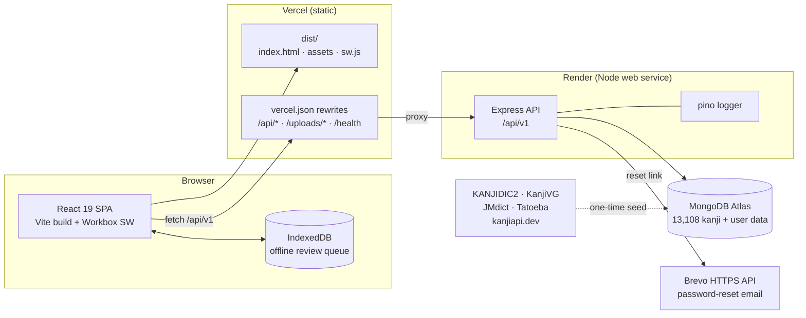

# Architecture

Kanji Garden is a JavaScript-only MERN application: a React SPA, an Express
JSON API, MongoDB (Atlas), and a one-time data pipeline that ingests the five
upstream sources from `prompt.md` §5.



## Monorepo layout

```
client/    React 19 + Vite SPA, Zustand auth/PWA stores, TanStack Query cache
server/    Express API, Mongoose models, services, seed + migration scripts
shared/    constants (SRS ratings, XP, quest/achievement IDs) + JSDoc typedefs
deploy/    smoke.mjs, deploy-client.ps1, vercel.json.tpl, nginx.conf
```

npm workspaces link `@kanjigarden/shared` into both apps, so rating/XP
constants cannot drift between client and server.

## Request lifecycle

1. The browser loads the SPA from Vercel (or nginx in Docker).
2. `client/src/lib/api.js` calls same-origin `/api/v1/...` with
   `credentials: 'include'` and `X-Requested-With: XMLHttpRequest`.
3. Vercel rewrites `/api/*` to the Render API (nginx does the same in Docker),
   keeping cookies same-origin.
4. Express runs helmet, CORS, JSON parsing, cookies, the CSRF header check,
   rate limits, then the `/api/v1` router.
5. Routes validate with Zod, call services/models, and return
   `{ success: true, data }` or `{ success: false, error: { code, message } }`.
6. TanStack Query caches server state; Zustand keeps the session and PWA
   status. A readable `kg_session=1` hint cookie lets the SPA skip an anonymous
   `/users/me` probe; the real JWTs stay in `HttpOnly` cookies.

## API surface (`/api/v1`)

Public: `GET /health`, `GET /kanji`, `GET /kanji/:character`, `GET /radicals`,
`GET /licenses`, `GET /assets/:id`, and the auth endpoints below.

| Area         | Endpoints                                                                                                                                                           |
| ------------ | ------------------------------------------------------------------------------------------------------------------------------------------------------------------- |
| Auth         | `POST /auth/register`, `/login`, `/refresh`, `/logout`, `/forgot-password`, `/reset-password`                                                                       |
| Users        | `GET/PATCH /users/me`, `PATCH /users/me/preferences`, `POST /users/me/onboarding`, `POST/DELETE /users/me/avatar`, `DELETE /users/me`                               |
| SRS          | `POST /progress/add`, `GET /progress/due`, `POST /progress/review`, `POST /progress/:cardId/undo`, `/suspend`, `GET /progress/stats`, `DELETE /progress/:character` |
| Gamification | `GET /gamification/profile`, `/achievements`, `POST /gamification/streak/repair`, `/store/purchase`, `/store/equip`                                                 |
| Quests       | `GET /quests/today`                                                                                                                                                 |
| Quiz         | `GET /quiz/overview`, `POST /quiz/start`, `POST /quiz/:sessionId/answer`, `/submit`                                                                                 |
| Stats        | `GET /stats`, `/heatmap`, `/forecast`, `/accuracy`, `/jlpt`, `/best-worst`                                                                                          |
| Store        | `GET /store/items`, `/inventory`                                                                                                                                    |
| Leaderboard  | `GET /leaderboard`                                                                                                                                                  |

Authenticated routes sit behind `requireAuth`; all mutating requests require
the CSRF header. The API is versioned by path (`/api/v1`), not a header.

## Data model (MongoDB collections)

| Collection                 | Purpose                                                                                       |
| -------------------------- | --------------------------------------------------------------------------------------------- |
| `kanjis`                   | Master catalogue: meanings, readings, strokes, SVG, words, sentences, JLPT/Jōyō/Jinmeiyō tags |
| `radicals`                 | 214 radicals with meanings, mnemonics, variants                                               |
| `users`                    | Account, preferences (theme, reminders), onboarding state                                     |
| `sessions`                 | Hashed refresh tokens, rotation/revocation metadata                                           |
| `passwordresettokens`      | Single-use reset tokens with expiry                                                           |
| `userprogresses`           | Per-user SRS card state (`new/learning/review/relearning`, ease, interval, due date)          |
| `reviewevents`             | Append-only review log (undo, stats, heatmap, accuracy)                                       |
| `gamificationprofiles`     | XP, level, streak, coins, freeze/repair state                                                 |
| `questdefs` / `userquests` | Quest definitions and per-day progress/claims                                                 |
| `quizsessions`             | Quiz questions, answers, scores                                                               |
| `achievements`             | Definitions and unlock criteria                                                               |
| `userinventories`          | Purchased themes/avatar frames and equip state                                                |
| `avatarassets`             | Mongo-backed avatar bytes in production                                                       |

Indexes are declared on the models (and added by the Phase 5–8 migrations);
the kanji catalogue additionally supports filtering by JLPT, stroke count,
radical, Jōyō/Jinmeiyō, frequency, and text search.

## Domain logic

**SRS (`server/src/services/srs.js`)** — modified SM-2, pure functions. New
cards enter learning steps in minutes; graduation is 1 day (Good) or 4 days
(Easy); review intervals are in days; ease moves −0.20/−0.15/0/+0.15 per
Again/Hard/Good/Easy, clamped to [1.30, 3.00]. Mastered means review state with
an interval ≥ 180 days. `dueDate = lastReviewedAt + interval`, rounded to the
minute. Undo restores the prior card snapshot from `reviewevents`; suspend
removes a card from the due queue without deleting history.

**Gamification** — XP/level/streak/coins are derived and persisted in
`gamificationprofiles`. Level thresholds and coin rewards live in
`shared/constants.js`; the server remains authoritative. Streak repair spends
coins within the allowed window. Achievements are evaluated after reviews,
quests, quiz completion, and purchases.

**Quests** — `questdefs` are seeded from the §6.7 phrase list. Daily progress
is computed from `reviewevents`/`quizsessions`/`userprogresses` and stored in
`userquests`, with claims idempotent per user per day.

**Quiz** — sessions snapshot question sets (meaning, reading, stroke order,
fill-in-the-blank), score answers server-side, then award XP/coins and update
quests on submit. Session documents prevent replaying the same answers.

**Stats** — aggregate pipelines over `reviewevents` and `userprogresses` for
heatmap, forecast, accuracy, JLPT breakdown, and best/worst kanji. The heavy
chart route is lazy-loaded in the client.

**Uploads** — `STORAGE_DRIVER=local` writes to `server/uploads` (dev/test);
`mongo` stores bytes in `avatarassets` and serves them from `/api/v1/assets/:id`
(and `/uploads/...` for local). Production uses Mongo because Render's disk is
ephemeral.

## Offline reviews (Phase 9)

The service worker precaches the app shell and public lists; it never caches
authenticated kanji detail or progress. When a rating cannot reach the API,
`client/src/lib/offlineQueue.js` stores it in IndexedDB scoped by user, with an
`eventId` and local `reviewedAt`. On reconnect, `offlineSync.js` flushes
chronologically; the server validates timestamps within a 24-hour window and
deduplicates by `eventId`. The offline banner announces queued reviews, and
sign-out/account deletion clears the queue plus the singleton Query cache
(D28).

## Security controls

- **Sessions:** 15-minute access JWT + 7-day opaque refresh token in
  `HttpOnly`, `Secure` (production), `SameSite=Strict` cookies; refresh tokens
  are hashed and rotated on use.
- **CSRF:** the cookie policy plus a required `X-Requested-With` header on
  every mutating request.
- **Transport/headers:** helmet CSP defaults, `nosniff`, `DENY` framing,
  strict referrer policy, no `X-Powered-By`.
- **Abuse:** 100 req/min general and 10 req/min auth limits per IP; Zod body
  validation; 2 MB avatar cap; bcrypt password hashing; short-lived,
  single-use password-reset tokens.
- **Secrets:** all keys come from environment variables; `.env` is ignored and
  a pre-commit script rejects secret-looking filenames.

## Environments

| Environment | Client                        | API                       | Database              |
| ----------- | ----------------------------- | ------------------------- | --------------------- |
| Local       | Vite dev server :5173 (proxy) | `node --watch` :4000      | Atlas or local mongod |
| Docker      | nginx :8080, proxies to `api` | API container :4000 (dev) | `MONGODB_URI`         |
| Production  | Vercel static + rewrite proxy | Render Node service       | Atlas                 |

See [`DEPLOY.md`](./DEPLOY.md) for the deployment runbook and
[`DECISIONS.md`](./DECISIONS.md) for the approved deviations (no Docker
MongoDB, client CLI deploys, storage driver, PWA scope).

## Seed pipeline

`download-data.js` caches KANJIDIC2, the KanjiVG zip, jmdict-simplified, and
Tatoeba exports in `server/.data/`. `seed-kanji.js` then parses 13,108
characters, attaches stroke SVGs by codepoint, enriches JLPT/Jōyō/Jinmeiyō from
kanjiapi.dev (cached), joins example words/sentences, and bulk-upserts in
batches of 500. `seed-radicals.js`, `seed-achievements.js`, and
`seed-quests.js` populate the remaining definitions. The run ends with the
§5.7 coverage report; a full pipeline takes 5–15 minutes and is idempotent.

## Testing

- **Server:** Vitest + Supertest against `mongodb-memory-server` (222 tests),
  covering auth, SRS math, quests, quizzes, store, stats, uploads, licenses,
  and validation/rate-limit edges.
- **Client:** Vitest + React Testing Library (111 tests) for screens, forms,
  offline queue, accessibility structure, and the footer attribution.
- **Live:** `deploy/smoke.mjs` (84 checks) through the Vercel proxy against the
  real Render API and Atlas data.
